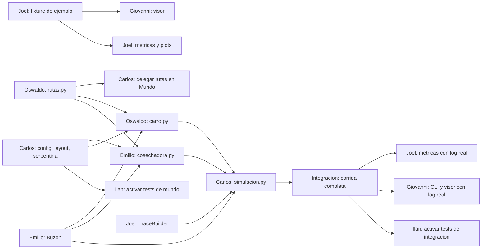

# Plan de trabajo — Primera entrega (lunes 16 de noviembre)

Reparto para 6 personas, dependencias, cronograma y flujo de git. Complementa a la [especificación](especificacion_primera_entrega.md), que dice **qué** construir; aquí se dice **quién** lo hace, **en qué orden** y **cómo se junta**.

---

## 1. Resumen en una pantalla

| Persona | Rama | Archivos que le pertenecen | Necesita para arrancar | Desbloquea a |
|---|---|---|---|---|
| **Carlos** (Mundo) | `branch-carlos` | `config.py`, `mundo.py`, `simulacion.py` | Nada para arrancar. `simulacion.py` necesita al final los agentes, el buzón y `TraceBuilder` | Emilio, Oswaldo, Ilan |
| **Oswaldo** (Rutas) | `branch-oswaldo` | `rutas.py`, `carro.py`, `tests/test_rutas.py`, `tests/test_carro.py` | Nada para `rutas.py`. `carro.py` necesita el buzón (Emilio) y el layout (Carlos), o fakes | Carlos, Emilio |
| **Emilio** (Coordinación) | `branch-emilio` | `mensajes.py`, `cosechadora.py`, `tests/test_mensajes.py`, `tests/test_cosechadora.py` | Nada para el buzón. `cosechadora.py` necesita el layout (Carlos) y `rutas.py` (Oswaldo), o fakes | Oswaldo, Carlos |
| **Joel** (Datos) | `branch-joel` | `telemetria.py`, `viz/plots.py`, `tools/`, `tests/fixtures/`, `tests/test_telemetria.py` | Nada. Es quien destraba al visor con el fixture | Giovanni, Carlos |
| **Giovanni** (Interfaz) | `branch-giovanni` | `viz/viewer.py`, `cli.py`, `tests/test_viewer.py` | El fixture de Joel (para el visor) y `simulacion.py` (para la CLI) | — |
| **Ilan** (Calidad) | `branch-ilan` | `tests/test_mundo.py`, `tests/test_config.py`, `tests/test_integracion.py`, `.github/`, `scripts/`, `README.md`, `docs/autoevaluacion.md` | Nada para escribir los tests (salen de la especificación) | Todos (CI y revisión) |

**Regla de oro:** cada archivo tiene un solo dueño. Si necesitas un cambio en un archivo ajeno, se lo pides al dueño (por chat o con un issue); no lo editas tú.

---

## 2. Qué cambió en el esqueleto para este reparto

Respecto a lo que subiste a GitHub, el esqueleto tiene estos ajustes (hay que hacer commit y push antes de que todos ramifiquen, ver §7):

- Nuevo `src/harvest_sim/rutas.py` con BFS, vecinos, celda objetivo y `siguiente_paso`, como funciones puras. Así Oswaldo trabaja sin depender del mundo.
- `Mundo` suma `registrar`, `ocupadas`, `bloqueadas_fijas`, `grano_cosechado`, `ancho`, `alto`, `entregado`, `grano_total`, y la función `duracion_ticks` a nivel de módulo.
- `telemetria.py` suma `TraceBuilder`, `cargar_trace` y `verificar_checksums`.
- Los tests se reparten por dueño: `test_rutas.py`, `test_carro.py`, `test_cosechadora.py`, `test_viewer.py` son nuevos. `test_agentes.py` desapareció (sus tests se movieron a los archivos anteriores y a `test_integracion.py`).
- Nuevas carpetas: `tests/fixtures/`, `scripts/`, `tools/`.

---

## 3. Reunión del viernes (45 min, todos)

Objetivo: confirmar las interfaces para que cada quien trabaje sin esperar. Es la única reunión obligatoria. Todo lo de abajo ya está propuesto; la reunión es para confirmar o corregir, no para diseñar desde cero.

### 3.1 Interfaces a confirmar

```python
# Atributos públicos de TODO agente (los lee el Mundo, el visor no los usa):
#   agent_id: str        posicion: tuple[int, int]     estado: Enum (EstadoCosechadora | EstadoCarro)
#   carga: int           capacidad: int

# --- Carlos: mundo.py ---
Mundo(config)
mundo.registrar(agente)                       # su posición inicial es su base
mundo.ancho, mundo.alto, mundo.bodega         # bodega == (0, 0)
mundo.base_de(agent_id) -> Celda
mundo.camino_serpentina() -> list[Celda]
mundo.posicion(agent_id) -> Celda             # lee agente.posicion
mundo.estado_de(agent_id) -> str              # lee agente.estado.value
mundo.ocupadas(excepto: str) -> set[Celda]    # celdas de los DEMÁS agentes
mundo.bloqueadas_fijas(agent_id) -> set[Celda]  # {bodega} para cosechadoras, vacío para carros (R9)
mundo.vecinos(celda) -> list[Celda]           # delega en rutas.vecinos
mundo.ruta_bfs(origen, destino, bloqueadas) -> list[Celda] | None   # delega en rutas.bfs
mundo.cosechar(agent_id, celda) -> int        # suma a agente.carga; R8
mundo.transferir(de, a, cantidad) -> int      # δ (R6); lanza ValueError si no son vecinos (R5)
mundo.depositar(agent_id) -> int              # carga del carro -> entregado
mundo.grano_cosechado() -> int
mundo.tick_actual                             # lo fija simulacion.py al inicio de cada tick
mundo.descripcion() -> dict                   # ancho, alto, bodega, bases, grano_por_celda (va en trace["mundo"])
mundo.cambios() -> list[dict]                 # CELDA_COSECHADA y DEPOSITO, en orden (va en trace["cambios"])
duracion_ticks(cantidad, tasa) -> int         # ceil(cantidad / tasa), mínimo 1

# --- Oswaldo: rutas.py (funciones puras) ---
vecinos(celda, ancho, alto) -> list[Celda]    # orden N, E, S, O
bfs(origen, destino, ancho, alto, bloqueadas) -> list[Celda] | None   # sin origen, con destino; [] si origen == destino
elegir_celda_objetivo(origen, objetivo, ancho, alto, bloqueadas, evitar) -> Celda | None
siguiente_paso(pos, ruta, destino, ancho, alto, ocupadas, bloqueadas_fijas) -> (Celda | None, list[Celda])

# --- Emilio: mensajes.py ---
buzon.enviar(msg) -> int                      # asigna id; se entrega en tick+1
buzon.entregar(tick)                          # al inicio de cada tick
buzon.leer(agent_id) -> Mensaje | None        # FIFO
buzon.hay_pendientes(agent_id) -> bool
buzon.registro() -> list[dict]                # id, tipo, emisor, receptor, tick_envio, tick_entrega, payload
                                              # además imprime cada envío y entrega con logging (§6.3 de la especificación)

# --- Joel: telemetria.py (estado real; el detalle está en docs/decisiones.md, 2026-11-15) ---
TraceBuilder(config: dict, mundo: dict, agentes: list[dict])   # mundo = Mundo.descripcion(); agentes = catálogo
builder.agregar_tick(tick, registros, eventos)  # en TODOS los ticks: registros completos sin checksum;
                                                # eventos = buzon.drenar_eventos() + mundo.drenar_eventos()
builder.construir(metricas=None) -> dict        # el trace v2.0
reconstruir(trace) -> estado completo de cada tick
calcular_metricas(trace) -> dict / series_temporales(trace) -> dict
validar_trace(trace) -> list[str]               # errores de formato del trace (vacía si está bien)
cargar_trace(ruta) / escribir_trace(trace, ruta) / verificar_checksums(trace) -> bool

# --- Carlos: simulacion.py (usa todo lo anterior) ---
ejecutar(config) -> dict                      # devuelve el trace completo, con métricas
```

### 3.2 Forma del registro de agente (`agente.registro(tick)`, sin checksum)

```python
{"tick": 12, "agent_id": "carro_1", "tipo": "carro",
 "pose": {"x": 3, "y": 2, "orientacion": "S"},
 "estado": "YENDO_A_COSECHADORA",
 "carga": {"actual": 0, "capacidad": 20},
 "intencion": {"accion": "MOVER", "celdas": [[3, 3], [4, 3]]},   # listas, no tuplas
 "objetivo": "cosechadora_1"}                                       # id | "bodega" | "base" | None
```

### 3.3 Vocabulario de `intencion.accion`

Joel calcula métricas leyendo estos valores, así que todos deben usar exactamente estos nombres:

| Valor | Cuándo |
|---|---|
| `MOVER` | El agente se mueve este tick |
| `COSECHAR` | La cosechadora cosecha una celda |
| `ESPERAR` | Espera por una causa normal (`LLENA_ESPERANDO`, `ESPERANDO_TRANSFERENCIA`) |
| `ESPERAR_BLOQUEO` | Espera porque la siguiente celda está ocupada (§4.2). Alimenta `ticks_bloqueados` |
| `TRANSFERIR` | Estado `TRANSFIRIENDO` |
| `DESCARGAR` | Estado `DESCARGANDO` |
| `NINGUNA` | `EN_BASE` sin trabajo, o `FIN` |

### 3.4 Acuerdos de trabajo

- Ramas, PR y revisión como en §7.
- Nadie edita archivos ajenos (§1).
- Todo lo no especificado se decide con la opción más simple y se escribe en `docs/decisiones.md`.
- Canal de chat único del equipo para avisos de cambios de interfaz.

---

## 4. Tareas por persona

Cada tarea lleva su criterio de **listo**. Las tareas están en orden de ejecución. Las marcadas con ⚡ destraban a otra persona: hazlas primero.

### Carlos — Mundo (`branch-carlos`)

Archivos: `config.py`, `mundo.py`, `simulacion.py`.

1. **Config.** `cargar_config(ruta)` con las validaciones del §3 de la especificación, lanzando `ValueError` con mensaje claro.
   *Listo cuando:* los tres JSON cargan y `test_config_invalida` de Ilan pasa.
2. ⚡ **Layout del mundo.** `Mundo.__init__`, `registrar`, `base_de`, `bodega`, `ancho`, `alto`, casillas con `n` y `m` genéricos (no escribir `(1,0)` ni `(2,0)` a mano), `bloqueadas_fijas`, `ocupadas`, `posicion`, `estado_de`.
   *Listo cuando:* `test_casillas_de_inicio` pasa. Súbelo a `development` cuanto antes: Emilio y Oswaldo lo necesitan.
3. ⚡ **Serpentina** y `duracion_ticks`.
   *Listo cuando:* `test_serpentina_cubre_todo_el_campo` y `test_duracion_ticks` pasan.
4. **Grano y cambios.** `cosechar` (R8), `transferir` (R5 y R6), `depositar`, `grano_cosechado`, `grano_total`, `entregado`. `cosechar` y `depositar` además **anotan el cambio** (`CELDA_COSECHADA` / `DEPOSITO`, con `tick_actual`), y agregas `descripcion()` y `cambios()` (§6.1 de la especificación).
   *Listo cuando:* los tests de R5, R6, R8, de depósito y `test_cosechar_registra_cambio` pasan.
5. **Delegar rutas.** `Mundo.vecinos` y `Mundo.ruta_bfs` llaman a `rutas.py` de Oswaldo.
6. **`simulacion.ejecutar`.** Crea mundo, buzón y agentes; ejecuta el bucle del §4.1 (entregar, cosechadora, carro, snapshot, término); fija `mundo.tick_actual` en cada tick, imprime por consola los cambios de estado y los depósitos (§6.3 de la especificación), arma el trace con `TraceBuilder` (pasándole `mundo.descripcion()` y `mundo.cambios()`) y llama `calcular_metricas`. Usa `max_ticks` como tope.
   *Listo cuando:* los tres escenarios terminan y cumplen las condiciones del §5.4. Hasta que lleguen los agentes reales, pruébalo con agentes falsos que terminen en pocos ticks.

**Respaldo:** Oswaldo.

### Oswaldo — Rutas y carro (`branch-oswaldo`)

Archivos: `rutas.py`, `carro.py`, `tests/test_rutas.py`, `tests/test_carro.py`.

1. ⚡ **`rutas.py`.** `vecinos` y `bfs` primero (los necesitan Carlos y Emilio), luego `elegir_celda_objetivo` y `siguiente_paso` (§4.2 y §5.2). Funciones puras, sin importar `Mundo`.
   *Listo cuando:* `tests/test_rutas.py` pasa completo, con el determinismo verificado.
2. **Fakes para tus pruebas.** Un `Mundo` falso y un `Buzon` falso mínimos dentro de `test_carro.py`. Así avanzas sin esperar a Carlos ni a Emilio.
3. **`carro.py`.** La tabla de estados del §5.2 completa: `EN_BASE` revisa su fila solo ahí; BFS con celdas ocupadas bloqueadas; celda objetivo según `elegir_celda_objetivo`; lectura de `cantidad` al recibir `TRANSFERENCIA_TERMINADA`; descarga con `duracion_ticks`.
   *Listo cuando:* `tests/test_carro.py` pasa con los fakes.
4. **`registro()` del carro** con `intencion.accion` del vocabulario del §3.3.
5. **Cambiar los fakes por los reales** cuando lleguen `mundo.py` y `mensajes.py` a `development`, y ajustar lo que haga falta.

**Respaldo:** Carlos.

### Emilio — Mensajería y cosechadora (`branch-emilio`)

Archivos: `mensajes.py`, `cosechadora.py`, `tests/test_mensajes.py`, `tests/test_cosechadora.py`.

1. ⚡ **`Buzon`.** Fila FIFO por agente, `id` entero creciente, entrega en `tick+1`, `registro()` para el log, y un registro por `logging` de cada envío y cada entrega (formato del §6.3 de la especificación).
   *Listo cuando:* `tests/test_mensajes.py` pasa (incluido `test_log_de_consola_de_mensajes`). Es lo primero que haces: Oswaldo, Carlos y Joel lo necesitan.
2. **Fakes para tus pruebas.** Un `Mundo` falso mínimo en `test_cosechadora.py`.
3. **`cosechadora.py`.** La tabla de estados del §5.1: viaje al campo (con `siguiente_paso` de Oswaldo), cosecha, evaluación de carga (llena o parcial final), espera del carro en `ESPERANDO_TRANSFERENCIA`, transferencia con `duracion_ticks` y `cantidad`, regreso a base y `FIN`. Si la siguiente celda de la serpentina está ocupada, espera con `ESPERAR_BLOQUEO`.
   *Listo cuando:* `tests/test_cosechadora.py` pasa con los fakes.
4. **`registro()` de la cosechadora.**
5. **Cambiar los fakes por los reales** cuando lleguen `mundo.py` y `rutas.py`.

**Respaldo:** Oswaldo.

### Joel — Datos (`branch-joel`)

Archivos: `src/harvest_sim/telemetria.py`, `viz/plots.py`, `tools/generar_trace_ejemplo.py`, `tools/validar_trace.py`, `tests/fixtures/`, `tests/test_telemetria.py`, `tests/test_plots.py`, `tests/test_validador.py`, `tests/test_generador.py`.

**Estado al 16 de noviembre: todo lo de esta entrega está hecho, salvo la tarea 5, que espera la simulación.** El formato del trace (v2.0) y las definiciones de las métricas están en `docs/decisiones.md` (entradas del 15 de noviembre). Ojo: el §6.1 de la especificación todavía describe el formato anterior.

| # | Tarea | Estado |
|---|---|---|
| 1 | **Trace v2.0** (`telemetria.py`): `TraceBuilder` (cambios por tick con eventos tipados y checksum por tick), `reconstruir`, `escribir_trace` (byte a byte reproducible), `cargar_trace` y `verificar_checksums` | Hecha |
| 2 | **Fixture de ejemplo** (`tools/generar_trace_ejemplo.py` → `tests/fixtures/trace_ejemplo.json`, 49 ticks, determinista), más `--escenarios` para tres traces de ejemplo en `runs/ejemplo/` | Hecha |
| 3 | **Métricas desde el log**: las 13 del §6.2 más una por cada variable en juego (% de ocio, ticks por estado, mensajes por tipo, distancia cosechadora–carro, grano esperado y % entregado) y series por tick | Hecha |
| 4 | **Gráficas y tabla** (`viz/plots.py`): carga de la cosechadora, línea de tiempo de estados, ocio acumulado, distancia cosechadora–carro, grano cosechado y en la bodega, y comparación entre escenarios; tabla resumen en CSV (todas las métricas) y Markdown (las principales) | Hecha |
| 5 | **Corridas reales y lectura de resultados** | Pendiente: necesita `simulacion.ejecutar` |
| 6 | **Validador del contrato del trace** (`tools/validar_trace.py`): estructura, ticks y checksums, eventos, agentes, mundo y mensajes, con el tick, el evento y el campo de cada error | Hecha |

El generador del fixture es una **herramienta de datos de prueba**: aplica las reglas del §5 de forma simplificada para producir traces de ejemplo. No es la simulación ni la reemplaza.

**Lo que el trace necesita de los demás** (contrato en `docs/decisiones.md`):
- **Carlos:** `Mundo.descripcion()`; `Mundo.drenar_eventos()` con `CELDA_COSECHADA`, `DEPOSITO` (con `entregado_total`) y `BLOQUEO` (vía `registrar_bloqueo`); y en `simulacion.ejecutar`, el tick 0 con el estado inicial antes del primer paso y `agregar_tick` en cada tick.
- **Emilio:** `Buzon.drenar_eventos()` con `MENSAJE_ENVIADO` y `MENSAJE_ENTREGADO`.
- **Emilio y Oswaldo:** `registro()` = `tick`, `agent_id`, `tipo`, `pose`, `estado` y `carga` (`{actual, capacidad}`), sin rutas ni intenciones.

**Hecho y retirado de esta entrega** (sigue en el historial de git de `branch-joel`):
- **Combustible y gasto** (tanque que se recarga en la base, costo del combustible y balance contra el valor del grano): el §1 de la especificación lo deja fuera de esta entrega. Queda para una entrega siguiente. Commit `4c634f4`.
- **Comparación de una corrida nueva contra la línea base** (`viz/comparar.py`): sirve cuando exista una segunda estrategia que comparar (semana 4). Commit `458e39d`.
- **Revisión de reglas físicas (R2, R3, R4 y R7) dentro del validador:** pasa a Ilan, en sus pruebas de integración (ver su tarea 2). Commit `d528372`.

**Respaldo:** Giovanni.

### Giovanni — Interfaz (`branch-giovanni`)

Archivos: `viz/viewer.py`, `cli.py`, `tests/test_viewer.py`.

1. **Visor con el fixture de Joel.** Mientras llega, arranca con un diccionario hecho a mano dentro del propio visor para la ventana y el grid. Mínimo del §7.1: grid, celdas cosechadas vs. por cosechar, bodega y bases marcadas, agentes con orientación, barra de carga, estado en texto, número de tick, estela. Controles: pausa, paso a paso, velocidad.
   El visor **no importa nada de `harvest_sim`**: solo lee el JSON. Toma el grid y las bases de `mundo`, y pinta las celdas cosechadas aplicando `cambios` a medida que avanza el tick (no las deduce de las posiciones).
   *Listo cuando:* reproduce el fixture de principio a fin.
2. **`tests/test_viewer.py`**: prueba de humo sin ventana (`SDL_VIDEODRIVER=dummy`) que dibuja varios cuadros del fixture.
3. **`cli.py`.** Cablea `cargar_config` → `ejecutar` → `escribir_trace` → gráficas, crea `runs/<escenario>/`, y devuelve un código de salida distinto de 0 si algo falla. Opciones `--sin-plots`, `--silencioso` y `--detallado`; la CLI configura el nivel de `logging` (§6.3 de la especificación).
   *Listo cuando:* `python -m harvest_sim.cli config/escenario_a.json` genera `trace.json`. Depende de que `simulacion.py` funcione (domingo); mientras tanto prueba con un `ejecutar` falso.
4. **Preguntas de integración con Unity** (si hay tiempo): una nota breve `docs/integracion_unity.md` con las cuatro preguntas de la propuesta (animar un movimiento, cargar un JSON en tiempo de ejecución, convertir una celda a posición 3D, incrustar la vista en una página). No se implementa Unity en esta entrega.

**Respaldo:** Joel.

### Ilan — Calidad (`branch-ilan`)

Archivos: `tests/test_mundo.py`, `tests/test_config.py`, `tests/test_integracion.py`, `.github/`, `scripts/`, `README.md`, `docs/autoevaluacion.md`.

1. **CI.** `.github/workflows/ci.yml` que, en cada push y PR, instale con `pip install -r requirements.txt` y `pip install -e .`, y ejecute `pytest -q` con Python 3.12 (y `SDL_VIDEODRIVER=dummy`). Primero esto: da una señal verde o roja a todos los demás.
   *Listo cuando:* corre en GitHub sobre `development`.
2. **Tests desde la especificación.** Escritos por quien no implementa el código: `test_mundo.py`, `test_config.py::test_config_invalida` (parametrizado con cada validación del §3) y `test_integracion.py` (R3, R4, R7 en cada tick, terminación, reproducibilidad, duración de estados, mensaje pendiente, `test_cambios_reconstruyen_el_mapa`). Se suben con `skip` y los vas **activando** a medida que cada módulo llega a `development`: un PR pequeño por módulo.
   *Listo cuando:* en `development` no queda ningún `skip` en tus archivos.
   *Recibido de Joel:* `reconstruir(trace)` (en `telemetria.py`) devuelve el estado completo de cada tick para revisar R2, R3, R4 y R7 desde el log. El validador de Joel solo revisa el formato del trace, así que estas pruebas son la comprobación de esas reglas sobre una corrida completa.
3. **Scripts.** `scripts/correr_todos.sh` (corre los tres escenarios y las gráficas) y `scripts/verificar_instalacion.sh` (crea un entorno virtual nuevo, instala, corre `pytest` y un escenario).
4. **Revisión.** Revisas la conformidad con la especificación en los PR grandes y mantienes el formato de `docs/decisiones.md`. Cuando haya conflicto entre lo que dice la especificación y lo que hizo alguien, lo señalas.
5. **Verificación final (domingo noche y lunes).** `verificar_instalacion.sh` en una máquina o carpeta limpia, README al día, y `docs/autoevaluacion.md` con la lista de verificación de la rúbrica (la del §12 de la especificación más la lista previa a la entrega del documento del curso), marcando lo que falta.

**Respaldo:** Carlos.

---

## 5. Dependencias



### Quién puede empezar ya, sin esperar a nadie

| Persona | Arranca con | Por qué no necesita esperar |
|---|---|---|
| Carlos | Config y layout | Solo usa la especificación |
| Oswaldo | `rutas.py` | Son funciones puras |
| Emilio | `Buzon` | No depende de nada |
| Joel | El fixture de ejemplo | Solo usa el formato del log |
| Giovanni | Ventana y grid del visor con datos de mano | No necesita el log todavía |
| Ilan | CI y tests | Salen de la especificación |

### Quién espera a quién (y con qué se desatora)

| Tarea que espera | Espera a | Mientras tanto |
|---|---|---|
| `carro.py` completo | `Buzon` (Emilio) y layout (Carlos) | Fakes dentro de `test_carro.py` |
| `cosechadora.py` completa | Layout (Carlos) y `rutas.py` (Oswaldo) | Fakes dentro de `test_cosechadora.py` |
| Visor completo | Fixture de Joel | Datos de mano |
| `simulacion.ejecutar` | Agentes, buzón y `TraceBuilder` | Agentes falsos que terminen rápido |
| CLI | `ejecutar` y `escribir_trace` | `ejecutar` falso |
| Métricas reales | Corrida completa | Fixture |

---

## 6. Cronograma

Hoy es viernes 13; la entrega es el lunes 16. Las horas son orientativas; lo importante es el orden y los hitos.

| Momento | Hito | Quién |
|---|---|---|
| **Viernes noche** | Reunión de 45 min (§3). Se hace commit y push de los cambios del esqueleto a `main` y `development`; cada quien crea o actualiza su rama | Todos |
| Viernes noche | CI funcionando; fixture de Joel (puede pasar al sábado temprano); `rutas.py` con `vecinos` y `bfs` | Ilan, Joel, Oswaldo |
| **Sábado mañana** | Buzón, config, layout del mundo y `bfs` en `development` | Emilio, Carlos, Oswaldo |
| Sábado mediodía | Serpentina, `duracion_ticks`, fixture de Joel disponible; Giovanni ya dibuja el fixture | Carlos, Joel, Giovanni |
| **Sábado tarde** | `cosechadora.py` y `carro.py` pasan sus tests con fakes; funciones de grano del mundo listas | Emilio, Oswaldo, Carlos |
| **Sábado noche** | **Hito 1:** una corrida de extremo a extremo, aunque sea fea (`ejecutar` con los agentes reales) | Carlos con Emilio y Oswaldo |
| **Domingo mañana** | `calcular_metricas` y `plots` sobre el log real; CLI funcionando; Ilan activa los tests de integración y corrige lo que falle | Joel, Giovanni, Ilan |
| Domingo tarde | Visor con el log real; gráficas de los tres escenarios; arreglo de bugs que salgan de los tests | Todos |
| **Domingo noche** | **Congelamiento:** solo se aceptan correcciones de errores, no funciones nuevas | Todos |
| **Lunes mañana** | `development` pasa CI; `verificar_instalacion.sh` en entorno limpio; resultados de los tres escenarios; merge `development` → `main` con etiqueta `v0.1-entrega1` | Ilan y Joel |

### Qué se recorta si el tiempo aprieta (en este orden)

1. La nota de Unity de Giovanni.
2. Funciones extra del visor (estela, velocidad ajustable); queda el reproductor básico.
3. Las gráficas 3 y 4 de Joel (quedan la 1 y la 2, más la tabla de métricas).
4. Escenarios B y C: se entrega con el A completo y los otros dos como configuración sin analizar.

**No se recorta:** reglas físicas con tests, log v1.0 con checksum, métricas, reproducibilidad y el README que funcione.

---

## 7. Flujo de git

### 7.1 Ramas

| Rama | Para qué | Quién escribe |
|---|---|---|
| `main` | Lo que se entrega. Solo se toca el lunes | Se actualiza por PR desde `development` |
| `development` | Integración: aquí se junta el trabajo de todos | Solo por PR desde las ramas personales |
| `branch-carlos`, `branch-oswaldo`, `branch-emilio`, `branch-joel`, `branch-giovanni`, `branch-ilan` | Una por persona | Su dueño |

### 7.2 Diagrama de versiones (ejemplo de cómo se verá el fin de semana)

```mermaid
gitGraph
   commit id: "Esqueleto"
   branch development
   checkout development
   commit id: "Ajustes del esqueleto"
   checkout development
   branch branch-joel
   checkout development
   branch branch-carlos
   checkout development
   branch branch-oswaldo
   checkout development
   branch branch-emilio
   checkout development
   branch branch-giovanni
   checkout development
   branch branch-ilan
   checkout branch-ilan
   commit id: "CI"
   checkout development
   merge branch-ilan id: "PR: CI"
   checkout branch-joel
   commit id: "Fixture de ejemplo"
   checkout development
   merge branch-joel id: "PR: fixture"
   checkout branch-oswaldo
   commit id: "vecinos y bfs"
   checkout development
   merge branch-oswaldo id: "PR: rutas basicas"
   checkout branch-emilio
   commit id: "Buzon FIFO con ids"
   checkout development
   merge branch-emilio id: "PR: buzon"
   checkout branch-carlos
   commit id: "Layout y serpentina"
   checkout development
   merge branch-carlos id: "PR: mundo base"
   checkout branch-emilio
   merge development id: "Emilio trae lo nuevo"
   commit id: "cosechadora"
   checkout branch-oswaldo
   merge development id: "Oswaldo trae lo nuevo"
   commit id: "carro"
   checkout development
   merge branch-emilio id: "PR: cosechadora"
   merge branch-oswaldo id: "PR: carro"
   checkout branch-carlos
   merge development id: "Carlos trae agentes"
   commit id: "simulacion.ejecutar"
   checkout development
   merge branch-carlos id: "PR: simulacion"
   checkout branch-joel
   merge development id: "Joel trae simulacion"
   commit id: "metricas y plots"
   checkout branch-giovanni
   merge development id: "Giovanni trae simulacion"
   commit id: "visor y CLI"
   checkout development
   merge branch-joel id: "PR: metricas"
   merge branch-giovanni id: "PR: visor y CLI"
   checkout main
   merge development tag: "v0.1-entrega1"
```

La idea que muestra el diagrama:

- El trabajo fluye siempre **rama personal → `development`** por pull request, y **`development` → rama personal** cuando necesitas lo de los demás.
- `main` se actualiza una sola vez, el lunes, con todo ya integrado y probado.
- Nadie hace push directo a `development` ni a `main`.

### 7.3 Rutina de cada sesión de trabajo

```bash
git switch branch-TU-NOMBRE
git fetch origin
git merge origin/development        # traer lo que los demás ya integraron
# ... trabajar en tus archivos, hacer commits pequeños ...
pytest                              # antes de subir
git push origin branch-TU-NOMBRE
# en GitHub: abrir Pull Request  branch-TU-NOMBRE  →  development
```

- **Commits pequeños y frecuentes** con el formato `[módulo] verbo: qué`, por ejemplo `[mundo] agrega serpentina` o `[buzon] asigna ids crecientes`.
- **Un PR por hito**, no uno gigante el domingo. Cada hito de la tabla del §6 es un PR.
- **Antes de abrir el PR:** traes `development` a tu rama, corres `pytest` y verificas que los tests de tu módulo pasan.

### 7.4 Reglas

1. **Solo tus archivos** (§1). Excepciones: `docs/decisiones.md` (agregas al final; si hay conflicto, conservas las dos versiones) y `requirements.txt` (avisa antes de tocarlo).
2. **Revisión obligatoria:** cada PR necesita una aprobación antes del merge. El revisor principal es quien **consume** tu código, así detecta problemas de interfaz pronto:

   | PR de | Lo revisa |
   |---|---|
   | Carlos | Emilio |
   | Oswaldo | Carlos |
   | Emilio | Oswaldo |
   | Joel | Giovanni |
   | Giovanni | Joel |
   | Ilan | Joel |

   En los PR grandes (agentes, simulación) Ilan hace además una pasada de conformidad con la especificación.
3. **CI en verde** antes de hacer merge. Si CI falla por un test que no es tuyo, avisa a su dueño.
4. **Merge con "Merge commit"** (no squash), para que el historial del diagrama se conserve.
5. **Si dependes de algo que aún no llega a `development`:** no copies el archivo de otra persona ni hagas merge de su rama; usa un fake dentro de tus tests (§5) y cambia al real cuando llegue.
6. **Si cambias una interfaz del §3.1:** avisa en el chat **antes** de subir el PR y anótalo en `docs/decisiones.md`.
7. **Protección de ramas** (la configura Joel como dueño del repo, en *Settings → Branches*): exigir PR, una aprobación y CI en verde para `main` y `development`.

### 7.5 Resolver un conflicto

Como cada archivo tiene un solo dueño, los conflictos serán raros. Si ocurre uno:

```bash
git merge origin/development        # aparece el conflicto
# abre los archivos con marcas <<<<<<<, elige qué conservar, quita las marcas
git add ARCHIVO
git commit                          # termina el merge
pytest
```

Si el conflicto está en un archivo que no es tuyo, **no lo resuelvas a ciegas**: pregunta a su dueño.

---

## 8. Criterios de listo para el PR

Antes de pedir revisión, marca todo:

- [ ] Hice merge de `origin/development` en mi rama y no hay conflictos.
- [ ] `pytest` pasa y los tests de mi módulo ya no están en `skip`.
- [ ] Solo toqué archivos míos (o avisé de la excepción).
- [ ] Respeto las firmas del §3.1 y el vocabulario del §3.3.
- [ ] Si tomé una decisión no cubierta por la especificación, la anoté en `docs/decisiones.md`.
- [ ] No dejé parámetros escritos en el código; todo viene de la configuración.

---

## 9. Riesgos y plan B

| Riesgo | Señal | Qué hacer |
|---|---|---|
| Integración tardía | A las 24 h nada corre junta | Hito 1 del sábado noche: una corrida fea pero completa. Si Emilio u Oswaldo no llegan, Carlos usa agentes falsos para validar el bucle |
| Se atrasa una persona | Su PR no llega a la hora del hito | Su respaldo (§4) toma la tarea; se avisa en el chat |
| Interfaz que cambia a mitad | Alguien cambia una firma | Regla 6 del §7.4: avisar antes y anotar |
| Las métricas no coinciden con lo esperado | Valores raros en el fixture o en la corrida | Joel y Ilan verifican a mano un ciclo corto; se corrige la definición, no se ajustan los datos |
| Conflictos de git | Merge con muchas marcas | §7.5 y preguntar al dueño del archivo |
| El visor no alcanza | Domingo tarde sin visor funcional | Recortes del §6 |

---

## 10. Qué se entrega el lunes

1. Repositorio con `main` actualizado y la etiqueta `v0.1-entrega1`.
2. `python -m harvest_sim.cli config/escenario_X.json` funciona para los tres escenarios y genera `trace.json` y gráficas.
3. `pytest` pasa completo, sin `skip` en los tests de reglas.
4. Visor que reproduce un log.
5. Tabla y gráfica de métricas de los tres escenarios.
6. README que funciona en un entorno limpio, y `docs/decisiones.md` con lo decidido durante el fin de semana.
